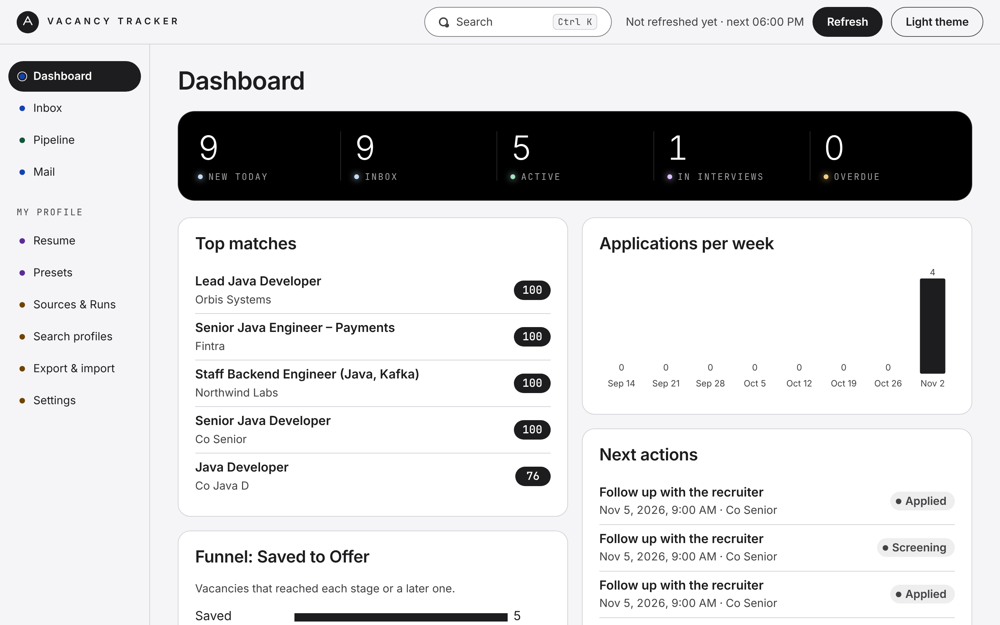
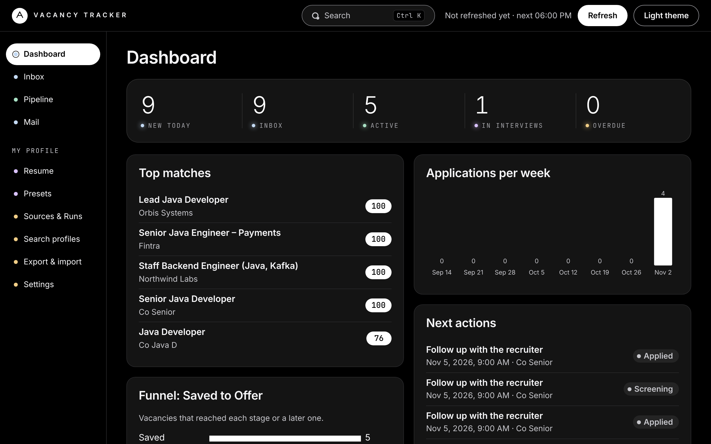
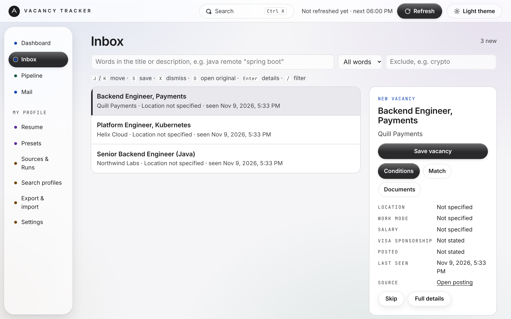
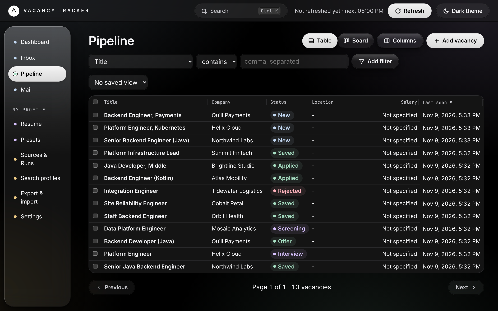

# Vacancy Tracker

A personal, self-hosted job search tool for a single user. It collects vacancies from official APIs, public feeds and your own job alert emails on a schedule, removes duplicates, scores each vacancy against your search profiles with explained reasons, and tracks every application through a pipeline with a full status history. Data can be exported to CSV, XLSX or JSON.

The code contains no roles, technologies, countries or salary thresholds. Everything is defined by you as data in search profiles.

Status: every planned task is done except a Jooble adapter (T-036), which is blocked until Jooble provides a key and its API documentation, and the backlog of the 2026-11-02 review (T-092). Two owner requests followed M7 (2026-11-03): an Inbox filter by words in the title or description (T-100) and the Beacon design with light, dark and system themes, selectable text size and a selected-vacancy panel in the Inbox (T-101). Milestone M6 (2026-11-02) added the full application cycle: resume and fit, AI-adapted documents behind an explicit opt-in, application packages, mail tracking, new sources and a design refresh. Milestone M7 (2026-11-02) added AI presets: base documents that AI adapts instead of writing new ones, an Employer match and a Goal match before and after, a resume PDF of at most two pages, and a fact check before saving. It runs on your own computer or on a VPS. See [PLAN.md](PLAN.md) for the full list and [CHANGELOG.md](CHANGELOG.md) for what changed when.

## Screenshots

The Beacon design in its graphite (monochrome) variant, light and dark. Source images are in [`design/vacancy-tracker-beacon-monochrome-v2`](design/vacancy-tracker-beacon-monochrome-v2).

| Light | Dark |
|---|---|
| <br>**Dashboard**: counts, top matches, applications per week and next actions | <br>**Dashboard** in the dark theme |
| <br>**Inbox**: keyboard triage with the selected vacancy beside the list | <br>**Pipeline**: the table with filters, statuses and bulk selection |

## How it works

1. **Collect.** Sources run on a schedule (or when you press Refresh). Each source is isolated: one failing source does not stop the others, and a run always ends with a summary.
2. **Normalize and deduplicate.** Titles, companies, places, salaries (with currency) and dates are brought to one shape. The same job from several sources is merged into one vacancy that remembers every source.
3. **Score.** Every enabled search profile scores each vacancy with the rules you wrote. The result shows the score and the reasons behind it. Rules that exclude a vacancy hide it from that profile.
4. **Triage and track.** The Inbox shows new matches for you to save or dismiss. Saved vacancies move through the pipeline (Saved, Applied, Screening, Test task, Interview, Offer, Accepted, Rejected, Withdrawn, and so on). Every change is kept in the history.
5. **Export.** Take your data out at any time as CSV, XLSX or a full JSON backup.

## Features

- Resume upload (PDF, DOCX, TXT, Markdown or pasted) and a fit score 0..100 for every vacancy with the reasons: matched and missing skills, title, years
- Presets: your search goal, the weights of its parameters, the resume and cover letter prompts, and your base resume and cover letter, set up once (the default preset's base resume is the resume above)
- Resume and cover letter for one vacancy: the base draft used as it is, or adapted by Claude (off by default, explicit opt-in; the official CLI under your subscription or an API key) under a fixed guardrail, compared line by line with the base, edited and saved as a numbered version that keeps a snapshot of what it was made from
- Employer match (how the document covers the employer's requirement checklist, with each quote checked by the app and the score computed by the app) and Goal match (how the vacancy fits your preset), as bars, with "Base 62% → Tailored 78% (+16)" after tailoring
- Fact check before saving: numbers, dates, employers, titles and technologies that are not in your base documents are shown, and saving waits until you fix them or confirm they are true
- Resume PDF for every saved version: A4, one column, real text, at most two pages (AI shortens at most twice, then you edit)
- Application package: the chosen versions as a ZIP with the resume PDF and a checklist, the application page opened for you (you submit the form yourself), and "I submitted" moves the vacancy to Applied with the versions in its history
- Mail tracking: answers of employers and LinkedIn notices from your mailbox (read-only), linked to the application with the reason, with a suggested status change you accept or dismiss
- Automatic and on-demand collection ("Refresh" button with live per-source progress)
- Inbox with keyboard triage (J/K, S, X, O), a filter by words in the title or description (all or any, with exclusions; "/" to jump to it) and score badges with reasons; the age of a posting ("posted 9 days ago") when the source gives a date, usable in profile rules (`postedAge`) and in the profile's `maxAgeDays`; a "Likely ghost" flag with its reasons (posted 30+ days ago, listed 30+ days since first seen, no salary: two of the three), computed from your own data, which a profile can use to hide them (`ghostSignals gte 2`)
- Pipeline as a table or a Kanban board, with status history, follow-up dates and bulk actions with Undo
- Dashboard: inbox and active counts, top matches, next actions, a funnel, applications per week, and "Time to follow up": applications in Applied, Screening or Interview with no status change and no mail for 10 days (`APP_FOLLOWUP_QUIET_DAYS`), unless you planned a later next action
- Search profiles built from rules (require, prefer, avoid, exclude), live preview, versions and a step-by-step wizard for the first one
- Company allow and block lists, which a profile can use
- Filters and saved views using the same rule model as search profiles
- Full-text search and Ctrl/Cmd+K command palette
- Export to CSV (UTF-8 with BOM), XLSX and full JSON backup; import with per-row error reports (a CSV import merges into existing vacancies and keeps the fields you edited by hand)
- Optional Telegram digest after a run, and an optional message when new mail suggests a status change (both disabled by default)
- Beacon design (design/README.md): calm, high-contrast, light first with a dark theme, 18 px text that can be raised to 22 px, four color roles with one meaning each, keyboard-first screens

## Sources

Each source is an adapter that is switched on and configured in `.env` (see `.env.example`):

| Kind | Sources |
|---|---|
| Official public APIs | Greenhouse, Lever, Ashby (company job boards you configure), Arbeitnow, Remotive, Himalayas, Jobicy, Remote OK, Working Nomads, Adzuna (free key) |
| Feeds | Djinni (shipped), and any RSS or Atom feed you configure after you have checked its terms |
| Telegram | Posts you forward to your own bot; the tool never reads channels itself (Telegram's terms forbid it) |
| Your job alert emails | LinkedIn, Jobs.cz, StartupJobs, Indeed. The tool reads alert emails from a mailbox folder you choose over IMAP; it never logs in to the job sites |
| Generic HTML | Only sites you configure with the terms recorded and `robots.txt` checked (off by default) |

Each source's terms, limits and status are recorded in [docs/sources.md](docs/sources.md). Some sources are blocked until their terms have been read in a browser, and the tool does not bypass protection against automated access.

## Security

- The app runs on `127.0.0.1` by default. On a VPS it sits behind Caddy with HTTPS and an access token; after five wrong tokens from one address that address is blocked for ten minutes.
- Writes from another site are refused, so a web page open in your browser cannot start a run or import data. The app answers only to `localhost`, `127.0.0.1` and the host names in `APP_ALLOWED_HOSTS` (the VPS domain), so a hostile page cannot reach a local instance through DNS rebinding.
- Links from sources and imports are stored and opened only when they are `http` or `https` addresses.
- Secrets (database password, access token, source keys, the Anthropic API key, IMAP and Telegram credentials) come only from `.env`. They are masked in logs.
- Importing a profile or vacancies from a URL refuses private and local addresses unless you allow them.
- **AI is off by default.** With `APP_AI_PROVIDER` unset nothing can reach Claude. When it is set to `cli` (the official Claude Code CLI under your own subscription) or `api` (`ANTHROPIC_API_KEY`), still nothing is sent until you switch AI on in Settings after reading what is sent; you can switch it off at any time. Even then text leaves only when you press Generate with AI: the vacancy you chose, the preset you picked (its main goal, the weights of its parameters and the document prompt), your base resume and base cover letter, and any instructions you add. A fixed guardrail goes first in every request: facts come only from your base documents, and the vacancy text is treated as untrusted data. Use as is sends nothing. To score the match, opening a vacancy with AI on sends the vacancy, the main goal with its weights and the documents being scored, once per text (the results are cached); the score itself is computed by the app, not by Claude. Mail and the rest of your data are never sent to Claude. The app never reads, copies or passes the CLI's OAuth token: the CLI signs in by itself, runs without tools, MCP servers or your own settings, and does not receive your API key.
- Mail: the IMAP reader only reads, never deletes, moves or sends, and looks only at mail of the last 14 days by default (`APP_MAIL_IMAP_MAX_AGE_DAYS`). "Delete" on the Mail screen removes only the app's stored copy. Of the folders it reads, only job-related mail is stored (sender, subject, date and the first part of the text); everything else is skipped and not kept.
- Nothing is sent to third parties except to the sources themselves. Telegram (digest and forwarded posts) and AI are opt-in.

See [docs/deployment.md](docs/deployment.md) for the details.

## Quick start

```sh
cp .env.example .env        # set POSTGRES_PASSWORD
docker compose up -d --build
```

Open <http://127.0.0.1:8080>. For a server with HTTPS and an access token see [docs/deployment.md](docs/deployment.md); for backups and restore see [docs/operations.md](docs/operations.md).

## Compliance

Only official APIs and feeds, plus job alert emails you receive, are used. Direct scraping of LinkedIn and other sites that prohibit it, CAPTCHA bypass, logging in with your account and proxy rotation are forbidden by design. See [docs/sources.md](docs/sources.md).

### Independence and third-party names

Vacancy Tracker is an independent personal project. It is not affiliated with or endorsed by any product or site it mentions, and it copies none of their text, code, design or data. Names and trademarks belong to their owners. See [docs/gap-analysis.md](docs/gap-analysis.md) for the one comparison with another kind of product and how it was made without breaching that site's terms. Licences of the components used are listed in [THIRD_PARTY_NOTICES.md](THIRD_PARTY_NOTICES.md).

## Repository structure

```
README.md                      this file
PLAN.md                        development plan and progress (source of truth)
tasks.csv                      the same tasks for GitHub Projects or Jira
CHANGELOG.md                   entries per completed task
docs/
  research.md                  comparable solutions and what we borrow
  sources.md                   sources, terms, limits, adapter capabilities
  architecture.md              C4 context and container, pipeline, ERD (Mermaid)
  decisions.md                 architecture decision records (ADRs)
  search-profiles.md           profile and criterion schema, score formula
  deployment.md                run locally, run on a VPS with HTTPS
  operations.md                backups and restore
  code-review.md               review of 2026-11-02: findings and their state
  gap-analysis.md              comparison with a kind of tool and the gaps closed
  examples/
    search-profile.example.yml neutral example, never loaded automatically
e2e/
  tests/smoke.spec.ts          Playwright smoke test (run: cd e2e && npm ci && npm run test:local)
  tests/full-cycle.spec.ts     Playwright test of the whole application cycle (fake AI, a test letter)
ops/
  backup/                      backup script and its Docker test
design/
  tokens.css                   design tokens (light and dark)
  dashboard.html               static clickable mockup with fake data
  README.md                    design rationale, states, keyboard shortcuts
```

Also in the repository: `backend/` (Java 21, Spring Boot, Maven), `frontend/` (Vite, TypeScript, Preact; built into the backend jar), `docker-compose.yml` and `docker-compose.vps.yml` (HTTPS and the access token), `ops/caddy/` (the proxy settings), `.github/workflows/ci.yml` and `.env.example`.

## Tech stack

- Backend: Java 21, Spring Boot 3.5, Maven, PostgreSQL 16, Flyway, plain SQL through `JdbcClient`, Jsoup, Rome (RSS and Atom), Jakarta Mail (IMAP), Apache POI (XLSX and DOCX), Apache PDFBox (reading resumes and writing the resume PDF, with the Liberation Sans font under the SIL Open Font License in `backend/src/main/resources/fonts`), the Anthropic Java SDK (optional AI), Actuator; Checkstyle, JaCoCo (80% line gate for the core modules) and ArchUnit in every build; Testcontainers for integration tests
- Modules (backend): `vacancy`, `collection`, `matching`, `export`, `notification`, `web`, `common`; their allowed dependencies are checked by ArchUnit
- Frontend: Vite, TypeScript (strict), Preact, no UI library; Vitest for the logic; built into static assets served by the backend
- End-to-end: a Playwright smoke test in `e2e/`, run against the built jar in a local Chrome
- Decisions: 46 recorded architecture decisions in [docs/decisions.md](docs/decisions.md)
- Deployment: Docker Compose (`app`, `postgres`, `backup`, and `caddy` on a VPS); secrets only in `.env`

## Tests

```sh
cd backend && mvn verify                   # unit and integration tests (needs Docker), style, coverage gate, architecture
cd frontend && npm ci && npm test          # logic tests; `npm run typecheck` for types
cd e2e && npm ci && npm run test:local     # browser tests (smoke, the full application cycle, then the M7 preset scenario; fake AI and a test letter only); need the built jar, Docker and Chrome
```

## Running it

See [docs/deployment.md](docs/deployment.md).
