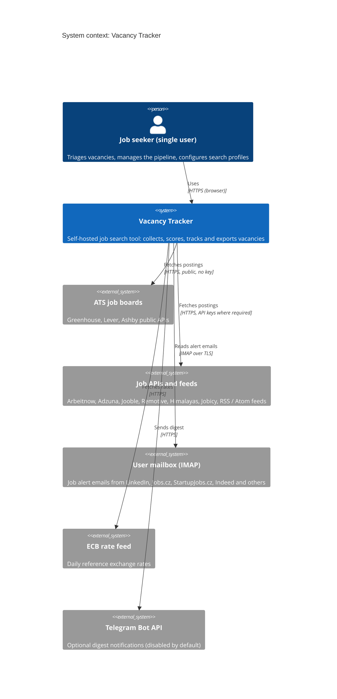
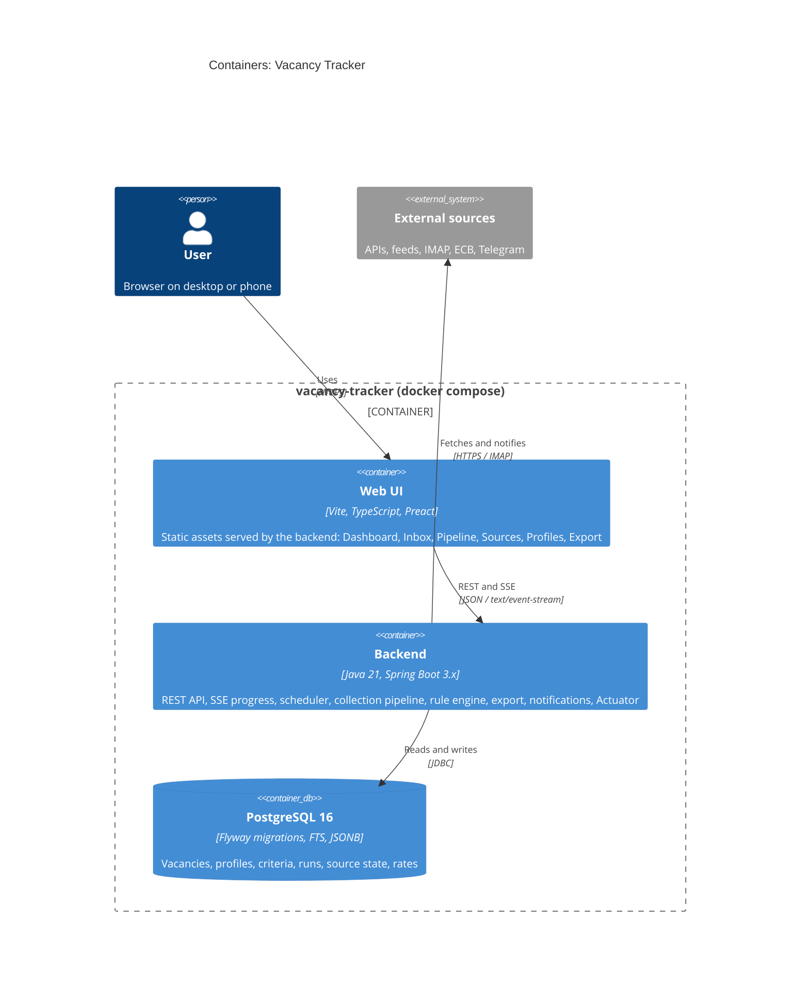
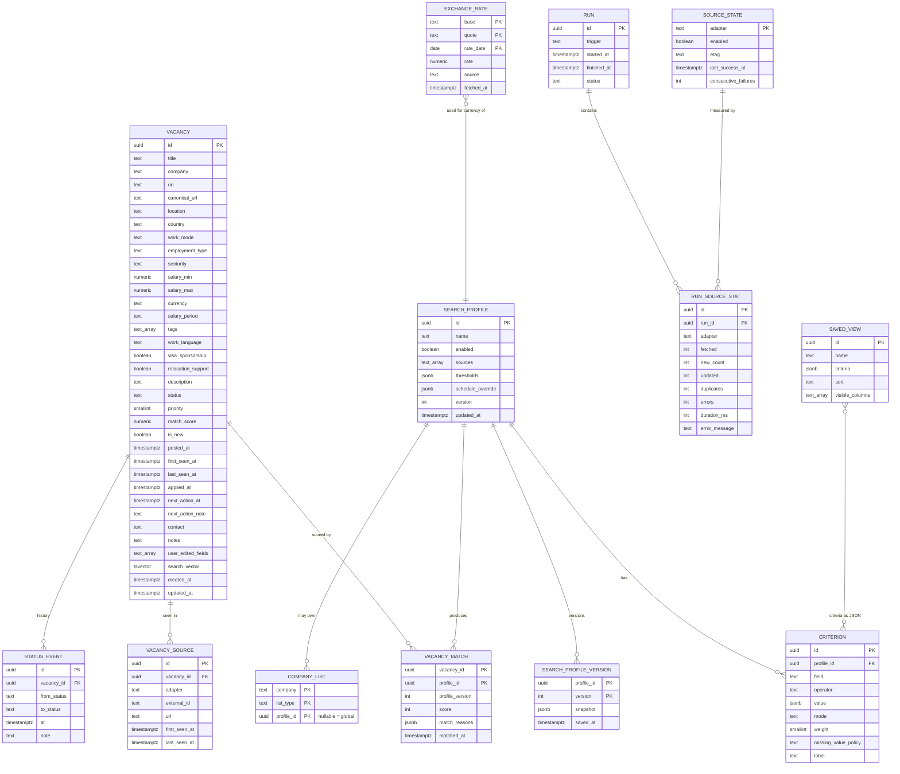

# Architecture

Status: Phase 0 (M0). Decisions are recorded in [decisions.md](decisions.md). Profile and criterion details are in [search-profiles.md](search-profiles.md).

## 1. C4: System context

Note: direct scraping of job sites is not part of the context by design (ADR-007).

## 2. C4: Container

Deployment units: `app` (backend with bundled static UI) and `postgres` (with a named volume). A `backup` job runs `pg_dump` daily into a volume.

## 3. Modular monolith packages

| Package | Responsibility | Depends on |
|---|---|---|
| `vacancy` | Vacancy model, statuses, StatusEvent, upsert rules, search, expiry | `common` |
| `collection` | Adapters, HTTP client, rate limits, circuit breaker, pipeline stages, scheduler, run lock, SSE progress | `vacancy`, `matching` (interfaces) |
| `matching` | SearchProfile, Criterion, rule engine, score, VacancyMatch, recalculation, currency rates | `vacancy` |
| `export` | CSV, XLSX, JSON backup and import with validation | `vacancy`, `matching` |
| `notification` | Telegram digest (disabled by default) | `vacancy`, `matching` |
| `web` | REST controllers, SSE endpoints, static UI serving, auth filter | all of the above |
| `common` | Time, IDs, error model, logging and masking helpers | none |

Rule: no package depends on `web`. Enforced by an ArchUnit test (M5 task).

## 4. Collection pipeline

```mermaid
flowchart LR
    A[Schedule or Refresh button] --> L{Run lock free?}
    L -- no --> R[Return active run id]
    L -- yes --> P[Build request params from enabled profiles]
    P --> F[Fetch per adapter<br/>rate limit, ETag, retries, circuit breaker]
    F -->|failure| FS[Record RunSourceStat error<br/>continue other sources]
    F --> N[Normalize<br/>HTML cleanup, salary, currency, period<br/>workMode, country, seniority]
    N --> C[Canonicalize URL<br/>strip utm and tracking params]
    C --> D{Dedup<br/>1 canonical URL<br/>2 source externalId<br/>3 fuzzy company+title+location}
    D -->|duplicate| M[Add VacancySource<br/>merge into existing vacancy]
    D -->|new| I[Insert vacancy]
    M --> U[Upsert rules<br/>never touch user fields]
    I --> U
    U --> Ma[Match for each active profile<br/>require / exclude filter<br/>prefer / avoid score<br/>matchReasons]
    Ma --> S[Store VacancyMatch per profile<br/>matchScore = best]
    S --> E[Expiry detection<br/>N unseen successful runs<br/>status New or Saved]
    E --> Done[Finish run, publish summary, SSE done event]
```

Stage contracts:
- Each stage takes and returns a `CandidateVacancy` value object; stages are pure functions except fetch and upsert.
- Each stage is unit-testable with fixtures.
- Failures inside fetch are isolated per source; failures in later stages for one vacancy are recorded and do not stop the run.

## 5. Scheduler and run lock

- `@Scheduled` with a cron expression (`app.collection.cron`). Per-profile schedule overrides are supported by merging into the global schedule: the run for a profile includes only the sources it enables.
- Lock: PostgreSQL advisory lock plus an in-process flag. A trigger during an active run returns the active run.
- Graceful shutdown: no new runs; the active run finishes its current source and is marked `interrupted` if needed.

## 6. ERD

Notes on the ERD:
- `VACANCY_MATCH` has a composite key (`vacancy_id`, `profile_id`); the row is replaced on recalculation, so there is no history of scores, only of profile versions.
- `COMPANY_LIST.profile_id` is nullable: null means the entry is global.
- `CRITERION` is stored per profile; criteria of `SAVED_VIEW` live in JSON (ADR-009).
- Primary key types are UUID (ADR-021).

## 7. Frontend structure

- Single-page app with hash-free routing and URL-stored filter state (`?status=New&score>=70`).
- Screens: Dashboard, Inbox, Pipeline (Table / Kanban), Vacancy drawer, Sources & Runs, Search profiles, Settings & Export.
- Live progress: `EventSource` on `/api/runs/{id}/events`.
- Design tokens: `design/tokens.css`; mockup: `design/dashboard.html`.

## 8. Security summary

- Local profile: no auth, bound to `127.0.0.1`.
- VPS profile: one access token from `.env`, HTTPS through a reverse proxy.
- Secrets only from `.env`; keys in URLs are masked in logs.
- No trackers, no third-party analytics, no data sent anywhere except to the configured sources and the optional Telegram bot.
